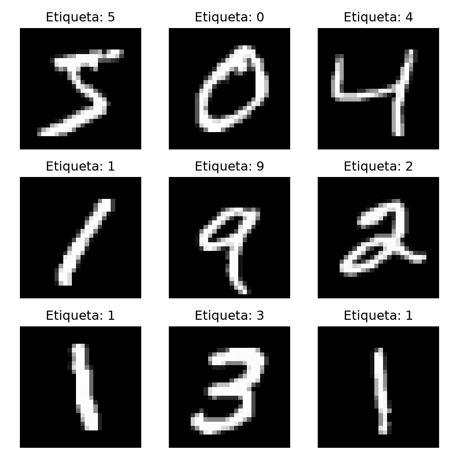
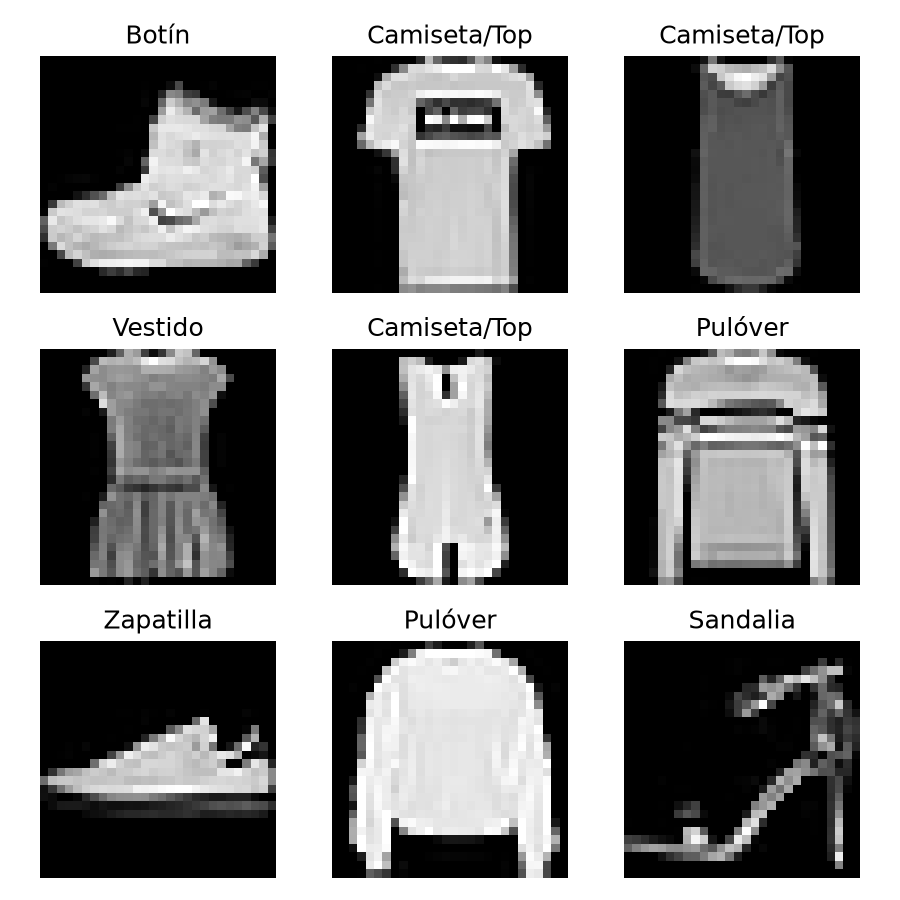

# Práctica de Laboratorio 05: Arquitecturas CNN y Análisis de Resultados (MNIST vs. Fashion-MNIST)

**Curso:** SIS070 - Inteligencia Artificial
**Unidad:** II - Redes Neuronales Convolucionales
**Alumno:** _[JUSTIN SEBASTIAN BARRIOS TAPIA, Helar René Vega lavajos, Marcie Brigitte jihuaña mamani]_
**Fecha:** _[12/10/2026]_

## Estructura del repositorio

```
practica-cnn-comparativa/
├── mnist_cnn.py        # Parte 1: CNN con dígitos (MNIST)
├── fashion_cnn.py      # Parte 2: CNN con prendas (Fashion-MNIST)
├── README.md           # Este informe
├── .gitignore
└── imagenes/           # Capturas generadas por los scripts
```

## Ejecución

```bash
pip install tensorflow matplotlib numpy
python mnist_cnn.py
python fashion_cnn.py
```

> **Nota:** `plt.show()` abre una ventana; ciérrala para que el script continúe. Cada script guarda además la cuadrícula en `imagenes/`.

> **Corrección al código base:** en la última línea de `fashion_cnn.py` la guía tenía un `}` sobrante (`...{y_test[0]})} "`), que provoca un `SyntaxError` en el f-string. Se corrigió. También se usó `layers.Input(shape=...)` en lugar de `input_shape=` dentro de `Conv2D`, para evitar la advertencia de Keras 3. La arquitectura no cambia.

---

# PARTE 1: MNIST

## 1. Inspección visual del dataset



Las 9 primeras imágenes de entrenamiento tienen las etiquetas **5, 0, 4, 1, 9, 2, 1, 3, 1**. Cada imagen es de 28×28 píxeles en escala de grises. Los trazos aparecen **blancos sobre fondo negro**: el fondo vale 0 y el trazo se acerca a 255. El dígito está centrado, ocupa casi todo el recuadro y tiene un grosor de 2 a 3 píxeles con bordes suavizados (anti-aliasing). Hay variación de estilo de escritura (inclinación, grosor, forma del 1 o del 4), pero cada imagen contiene un único objeto simple.

**Por qué es útil verlos antes de entrenar:**
- Se verifican las **etiquetas** (que `y_train[i]` coincida con la imagen).
- Se confirma el **formato**: tamaño, canal único, orientación y contraste.
- Se anticipa la **dificultad del problema**: trazos simples y centrados implican que la CNN no necesita aprender patrones muy complejos.
- Se detecta ruido o variabilidad que justifique el preprocesamiento (aquí, normalizar a [0, 1] y añadir el canal).

## 2. `model.summary()` y shapes

| Capa | Shape de salida | Parámetros |
|---|---|---|
| Conv_1 (Conv2D 32, 3×3) | (None, 26, 26, 32) | 320 |
| MaxPool_1 (2×2) | (None, 13, 13, 32) | 0 |
| Conv_2 (Conv2D 64, 3×3) | (None, 11, 11, 64) | 18,496 |
| MaxPool_2 (2×2) | (None, 5, 5, 64) | 0 |
| Aplanado_Flatten | (None, 1600) | 0 |
| Capa_Densa_Oculta (64) | (None, 64) | 102,464 |
| Salida_Softmax (10) | (None, 10) | 650 |
| **Total** | | **121,930** |

**Por qué Conv_1 reduce 28×28 a 26×26.** Sin *padding* (`padding='valid'`), un kernel de 3×3 solo se puede colocar donde cabe completo dentro de la imagen. La fórmula es:

```
salida = (entrada − kernel + 2·padding) / stride + 1 = (28 − 3 + 0)/1 + 1 = 26
```

El kernel pierde 1 píxel de borde en cada lado (2 en total por eje), de modo que 28 − 2 = 26. La salida tiene **32 mapas de características** porque hay 32 filtros.

**Cómo interviene MaxPool_1.** Divide el mapa en ventanas de 2×2 sin solapamiento (stride = 2 por defecto) y conserva solo el **máximo** de cada ventana: 26/2 = **13**. Por tanto, 26×26×32 pasa a 13×13×32. Esto reduce a la mitad el alto y el ancho (el número de activaciones baja a una cuarta parte), disminuye el costo computacional, aporta invariancia a pequeños desplazamientos y conserva las activaciones más fuertes. No tiene parámetros entrenables.

## 3. Análisis de parámetros

**Conv_2.** Cada filtro tiene tamaño 3×3 y recorre **todos los canales de entrada** (los 32 mapas que salen de MaxPool_1). Cada filtro lleva además un sesgo:

```
parámetros = (kernel_alto × kernel_ancho × canales_entrada + 1) × n_filtros
           = (3 × 3 × 32 + 1) × 64
           = 289 × 64
           = 18,496
```

Desglose: pesos = 3·3·32·64 = 18,432; sesgos = 64; total = **18,496**.

**Función de Flatten.** Las capas convolucionales y de pooling trabajan con tensores 4D (batch, alto, ancho, canales), pero las capas `Dense` esperan un **vector 1D** por muestra. Flatten convierte el tensor 5×5×64 en un vector de 5·5·64 = **1600** valores, de modo que cada uno se conecte con las neuronas densas. No tiene parámetros entrenables: solo reorganiza los datos, y es el puente entre la extracción de características (convolución) y la clasificación (capas densas). Con esto, la capa densa de 64 neuronas tiene 1600·64 + 64 = **102,464** parámetros, que es la mayor parte del modelo.

## 4. Resultados en consola (MNIST)

**`model.summary()`:**

```
Model: "sequential"
┏━━━━━━━━━━━━━━━━━━━━━━━━━━━━━━━━━━━━━━┳━━━━━━━━━━━━━━━━━━━━━━━━━━━━━┳━━━━━━━━━━━━━━━━━┓
┃ Layer (type)                         ┃ Output Shape                ┃         Param # ┃
┡━━━━━━━━━━━━━━━━━━━━━━━━━━━━━━━━━━━━━━╇━━━━━━━━━━━━━━━━━━━━━━━━━━━━━╇━━━━━━━━━━━━━━━━━┩
│ Conv_1 (Conv2D)                      │ (None, 26, 26, 32)          │             320 │
│ MaxPool_1 (MaxPooling2D)             │ (None, 13, 13, 32)          │               0 │
│ Conv_2 (Conv2D)                      │ (None, 11, 11, 64)          │          18,496 │
│ MaxPool_2 (MaxPooling2D)             │ (None, 5, 5, 64)            │               0 │
│ Aplanado_Flatten (Flatten)           │ (None, 1600)                │               0 │
│ Capa_Densa_Oculta (Dense)            │ (None, 64)                  │         102,464 │
│ Salida_Softmax (Dense)               │ (None, 10)                  │             650 │
└──────────────────────────────────────┴─────────────────────────────┴─────────────────┘
 Total params: 121,930 (476.29 KB)
 Trainable params: 121,930 (476.29 KB)
 Non-trainable params: 0 (0.00 B)
```

La salida de la consola coincide exactamente con el cálculo manual de las secciones 2 y 3.

**Entrenamiento (1 época, 5000 muestras, 79 lotes):**

```
79/79 - accuracy: 0.7692 - loss: 0.7998
```

**Predicción de `X_test[0]`:**

```
Vector de probabilidades crudas (Softmax):
[0.000e+00 0.000e+00 2.000e-04 5.000e-04 1.000e-04 1.000e-04 0.000e+00
 9.988e-01 0.000e+00 3.000e-04]
Suma del vector: 1.0000
Clase predicha por el modelo: 7
Clase real de la imagen: 7
```

Equivalente en notación decimal:

| Clase | 0 | 1 | 2 | 3 | 4 | 5 | 6 | **7** | 8 | 9 |
|---|---|---|---|---|---|---|---|---|---|---|
| Probabilidad | 0.0000 | 0.0000 | 0.0002 | 0.0005 | 0.0001 | 0.0001 | 0.0000 | **0.9988** | 0.0000 | 0.0003 |

**Interpretación.**

- **Suma = 1.0000.** Softmax convierte los 10 valores brutos (logits) en una distribución de probabilidad: cada componente está en (0, 1) y todas suman 1. Aquí: 0.0002 + 0.0005 + 0.0001 + 0.0001 + 0.9988 + 0.0003 = 1.0000. Cada valor es la probabilidad que el modelo asigna a que la imagen sea ese dígito (el índice coincide con el dígito).
- **`np.argmax(predicciones)`** devuelve el **índice del valor máximo** del vector. El mayor valor es 0.9988, en la posición 7, así que devuelve **7**. Como en MNIST el índice coincide con el dígito, ese índice es directamente la clase predicha.
- **Contraste con `y_test[0]`.** La etiqueta real es **7**, igual que la predicción, por lo que la clasificación es **correcta**.
- **Confianza.** El modelo asigna **99.88 %** a la clase 7; las otras nueve clases suman apenas 0.12 %. Es una distribución casi de tipo *one-hot*, algo notable tras una sola época con 5000 muestras.

---

# PARTE 2: Fashion-MNIST

## 1. Inspección visual del dataset



Las 9 primeras imágenes de entrenamiento son: **Botín, Camiseta/Top, Camiseta/Top, Vestido, Camiseta/Top, Pulóver, Zapatilla, Pulóver, Sandalia**.

**Diferencias frente a MNIST:**
- Las prendas **no son trazos finos**, sino **siluetas con área rellena**, con texturas, pliegues, costuras y degradados de gris, no solo blanco y negro.
- Hay mucha **variación intra-clase** (distintos modelos de zapatilla o de camiseta) y **similitud inter-clase** (Camiseta vs. Camisa vs. Pulóver vs. Abrigo comparten forma casi idéntica).
- Los objetos varían en proporción (alargados, anchos, con huecos como en las sandalias), mientras que los dígitos tienen formas más uniformes.
- Mayor ocupación del recuadro y mayor cantidad de píxeles "activos" por imagen.

Esto hace al problema **más difícil**, aunque el formato (28×28, 10 clases) sea idéntico.

## 2. Análisis de la salida nominal

El modelo solo produce un vector de 10 probabilidades, y el entero que devuelve `np.argmax` (por ejemplo 9) no tiene significado semántico por sí mismo. El arreglo `class_names` actúa como **tabla de consulta** (*lookup*): la posición `i` guarda el nombre de la clase `i`. Así, `class_names[indice_predicho]` convierte el índice en texto legible, por ejemplo `class_names[9]` → `'Botín'`. Lo mismo ocurre con `class_names[y_test[0]]` para la etiqueta real y con los títulos de las gráficas.

Esto funciona porque el orden del arreglo **coincide exactamente** con la codificación del dataset (0 = Camiseta/Top, 1 = Pantalón, …, 9 = Botín). Si el orden fuera incorrecto, el modelo podría predecir bien pero se reportaría la prenda equivocada. La red nunca "ve" los nombres; son solo una capa de interpretación para humanos.

## 3. Impacto de la capa densa modificada (64 → 128)

| Capa | MNIST (64) | Fashion (128) |
|---|---|---|
| Conv_1 | 320 | 320 |
| Conv_2 | 18,496 | 18,496 |
| Capa_Densa_Oculta | 1600·64+64 = **102,464** | 1600·128+128 = **204,928** |
| Salida_Softmax | 64·10+10 = **650** | 128·10+10 = **1,290** |
| **Total** | **121,930** | **225,034** |

Duplicar las neuronas ocultas añade **103,104 parámetros** (+84.6 %). El aumento se concentra en la capa densa oculta (+102,464) y en la de salida (+640); las capas convolucionales no cambian porque dependen de filtros y canales, no del tamaño de la capa densa.

**Implicancia:** las prendas tienen patrones más complejos y más variación intra-clase, por lo que se necesita **mayor capacidad de representación** para combinar las 1600 características extraídas y separar clases parecidas (camiseta/camisa/pulóver/abrigo). Más neuronas permiten aprender más combinaciones no lineales. El costo es **más memoria, más tiempo de cómputo y mayor riesgo de sobreajuste**, sobre todo con pocos datos (aquí 5000 muestras).

## 4. Resultados en consola (Fashion-MNIST)

**`model.summary()`:**

```
Model: "sequential"
┏━━━━━━━━━━━━━━━━━━━━━━━━━━━━━━━━━━━━━━┳━━━━━━━━━━━━━━━━━━━━━━━━━━━━━┳━━━━━━━━━━━━━━━━━┓
┃ Layer (type)                         ┃ Output Shape                ┃         Param # ┃
┡━━━━━━━━━━━━━━━━━━━━━━━━━━━━━━━━━━━━━━╇━━━━━━━━━━━━━━━━━━━━━━━━━━━━━╇━━━━━━━━━━━━━━━━━┩
│ Conv_1 (Conv2D)                      │ (None, 26, 26, 32)          │             320 │
│ MaxPool_1 (MaxPooling2D)             │ (None, 13, 13, 32)          │               0 │
│ Conv_2 (Conv2D)                      │ (None, 11, 11, 64)          │          18,496 │
│ MaxPool_2 (MaxPooling2D)             │ (None, 5, 5, 64)            │               0 │
│ Aplanado_Flatten (Flatten)           │ (None, 1600)                │               0 │
│ Capa_Densa_Oculta (Dense)            │ (None, 128)                 │         204,928 │
│ Salida_Softmax (Dense)               │ (None, 10)                  │           1,290 │
└──────────────────────────────────────┴─────────────────────────────┴─────────────────┘
 Total params: 225,034 (879.04 KB)
 Trainable params: 225,034 (879.04 KB)
 Non-trainable params: 0 (0.00 B)
```

**Entrenamiento (1 época, 5000 muestras, 79 lotes):**

```
79/79 - accuracy: 0.6578 - loss: 0.9691
```

**Predicción de `X_test[0]`:**

```
Vector de probabilidades crudas (Softmax):
[1.200e-03 2.000e-04 3.400e-03 1.100e-03 3.000e-04 9.600e-02 8.000e-04
 1.245e-01 1.790e-02 7.545e-01]
Suma del vector: 1.0000
Clase predicha: Botín (Índice 9)
Clase real: Botín (Índice 9)
```

Equivalente en notación decimal:

| Índice | Clase | Probabilidad |
|---|---|---|
| 0 | Camiseta/Top | 0.0012 |
| 1 | Pantalón | 0.0002 |
| 2 | Pulóver | 0.0034 |
| 3 | Vestido | 0.0011 |
| 4 | Abrigo | 0.0003 |
| 5 | Sandalia | 0.0960 |
| 6 | Camisa | 0.0008 |
| 7 | Zapatilla | 0.1245 |
| 8 | Bolso | 0.0179 |
| **9** | **Botín** | **0.7545** |

El modelo clasificó correctamente la muestra (Botín), pero con una confianza del **75.45 %**, muy inferior al 99.88 % de MNIST. La probabilidad restante se reparte sobre todo entre otras prendas de calzado: Zapatilla (12.45 %) y Sandalia (9.60 %).

---

# PARTE 3: Análisis comparativo

## 1. Comparativa de métricas de entrenamiento

| Métrica (1 época, 5000 muestras, lote 64) | MNIST | Fashion-MNIST | Diferencia |
|---|---|---|---|
| Loss | 0.7998 | 0.9691 | Fashion +0.1693 (+21.2 %) |
| Accuracy | 0.7692 (76.92 %) | 0.6578 (65.78 %) | MNIST +11.14 puntos |
| Parámetros totales | 121,930 | 225,034 | Fashion +103,104 |
| Confianza en `X_test[0]` | 99.88 % | 75.45 % | MNIST +24.43 puntos |

**¿En cuál aprende más rápido o eficientemente? En MNIST.** Con las mismas 79 actualizaciones de pesos, MNIST alcanza menor pérdida y mayor precisión, a pesar de tener **casi la mitad de parámetros** (121,930 frente a 225,034). Esto indica que la red más grande no compensa la mayor dificultad de la tarea. Razones:

- **Separabilidad:** los dígitos son trazos simples, centrados y de alto contraste, por lo que los filtros aprenden bordes y curvas útiles en pocas iteraciones.
- **Similitud entre clases en Fashion-MNIST:** Camiseta, Camisa, Pulóver y Abrigo son casi indistinguibles a 28×28, y lo mismo ocurre con Zapatilla, Sandalia y Botín. Hay que aprender detalles finos de textura y forma, lo que exige más iteraciones.
- **Eficiencia por parámetro:** MNIST obtiene más precisión con menos parámetros; en Fashion-MNIST, parte de la capacidad extra aún no se aprovecha en una sola época.

**Matices metodológicos:**
- El `loss` y el `accuracy` que imprime Keras durante `fit` son **promedios acumulados sobre los 79 lotes** de la época, no el estado final del modelo. Como al inicio los pesos son aleatorios (la pérdida inicial de un clasificador de 10 clases es cercana a ln 10 ≈ 2.30), estos promedios subestiman la calidad del modelo al terminar la época. Por eso el modelo de MNIST puede acertar con 99.88 % de confianza aunque el accuracy promedio sea 76.9 %.
- Los resultados dependen de la inicialización aleatoria, así que otra ejecución dará cifras algo distintas, aunque la tendencia (MNIST mejor que Fashion-MNIST) es robusta.
- Se evaluó una única imagen de prueba, que ilustra el comportamiento pero no mide el rendimiento general. Para eso habría que usar `model.evaluate(X_test, y_test)`.

## 2. Complejidad visual y de patrones

- **Dígitos (MNIST):** trazos finos, un solo objeto centrado, fondo uniforme y alto contraste. El espacio de características es compacto y las clases se distinguen por formas claras (un lazo, una línea, una curva).
- **Prendas (Fashion-MNIST):** siluetas rellenas, con texturas, pliegues, degradados de gris y proporciones variadas. Hay mucha variación dentro de una misma clase y mucha semejanza entre clases (Camiseta/Camisa/Pulóver/Abrigo; Zapatilla/Sandalia/Botín).

**Efecto sobre Softmax.** Softmax reparte la probabilidad según qué tan separados queden los logits. Cuando las clases son claramente distintas (MNIST), un logit se impone con claridad y Softmax concentra casi toda la probabilidad en esa clase (99.88 %). Cuando hay clases visualmente parecidas (Fashion-MNIST), los logits de varias clases quedan más cercanos y Softmax distribuye la probabilidad entre ellas, de modo que el vector es menos "picudo" y la confianza en la ganadora baja (75.45 %). Como Softmax normaliza a 1, cada punto de probabilidad que se asigna a una clase confundible se resta de la ganadora.

## 3. Distribución de confianza del modelo

| | MNIST (dígito 7) | Fashion-MNIST (Botín) |
|---|---|---|
| Probabilidad de la clase ganadora | 0.9988 | 0.7545 |
| Segunda mayor probabilidad | 0.0005 (clase 3) | 0.1245 (Zapatilla) |
| Margen entre 1.ª y 2.ª | ≈ 0.998 | ≈ 0.630 |
| Resto de clases | Todas ≤ 0.0005 | Una más por encima de 0.09 (Sandalia 0.0960) |

- **MNIST:** hay una **probabilidad fuertemente dominante** en una única clase; las otras nueve suman solo 0.12 %. La distribución es casi *one-hot*, lo que refleja un dominio con patrones limpios y poca ambigüedad.
- **Fashion-MNIST:** la clase correcta domina, pero con una distribución **más dispersa**. La probabilidad restante no se reparte al azar, sino que se concentra en clases **semánticamente cercanas**: entre Zapatilla (0.1245), Sandalia (0.0960) y Botín (0.7545) suman 97.5 %, es decir, el modelo "sabe" que se trata de calzado y duda solo sobre cuál. Las prendas de torso (Camiseta, Pulóver, Abrigo, Camisa) y el Pantalón reciben probabilidades inferiores al 0.4 %.

**Conclusión:** la certeza de la red depende del **dominio de los datos**. Cuanto más distintiva y homogénea es cada clase, más concentrada es la distribución de salida; cuanto más se parecen entre sí las clases, más se dispersa la probabilidad entre ellas. Además, la confianza no equivale a la corrección: aunque en ambos casos el modelo acertó, una probabilidad alta no garantiza una predicción correcta (una red puede estar muy segura y equivocada), y con una sola época las probabilidades no deben interpretarse como bien calibradas.

---

# PARTE 4: Subida a GitHub

```bash
git init
git add .
git commit -m "Entrega completa: Practica comparativa CNN MNIST y Fashion-MNIST con visualizacion y analisis"
git branch -M main
git remote add origin https://github.com/Sebastian1539/GUIA-05-IA.git
git push -u origin main
```

**Enlace al repositorio:** _[https://github.com/Sebastian1539/GUIA-05-IA.git]_ 
